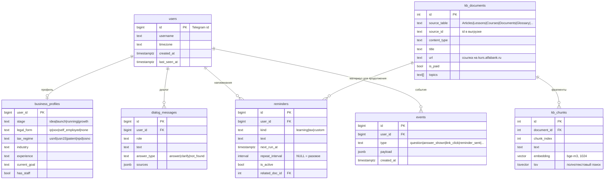

# Схема БД

Две базы в одном Postgres:

* `alfa_source` — выгрузка кейса как есть (восстанавливается из `data/alfa_course_hackathon.backup`), только читаем.
* `alfa_bot` — данные бота и индекс базы знаний. DDL: [`db/schema.sql`](../db/schema.sql).

## Что откуда берётся в индексе

| Тип | Таблицы выгрузки | Ссылка | Что индексируем |
|---|---|---|---|
| Статьи (834) | `Articles` + `ArticleEmbedItems` | `/articles/{Url}/` | опубликованные, полный текст |
| Курсы (33) | `Courses` | `/courses/{Url}/` | описание, цена, доступ |
| Уроки (235) | `Lessons` + `LessonEmbedItems` | страница курса | только уроки бесплатных курсов |
| Шаблоны (247) | `Documents` + `DocumentEmbedItems` | `/documents/{Url}/` | описание и текст |
| Глоссарий (351) | `Glossary` + `GlossaryEmbedItems` | `/vocabulary/{Url}/` | определения |
| Вебинары, подкасты | `Webinars`, `Podcasts` | `/webinars/…`, `/podcasts/…` | описания |

Платный курс: `Courses.Cost > 0` или курс входит в подписку «Курс+» (`CourseSubscriptions`).
Тексты платных уроков в индекс не попадают, бот только коротко называет пользу и даёт ссылку.

## Метрика возврата

`events` пишет каждое действие пользователя в боте. Возврат на платформу считаем по
`link_click` (переход по ссылке на материал) и `reminder_open` (переход из напоминания):
доля пользователей с переходом за 7 дней и число дней с переходами на пользователя.
