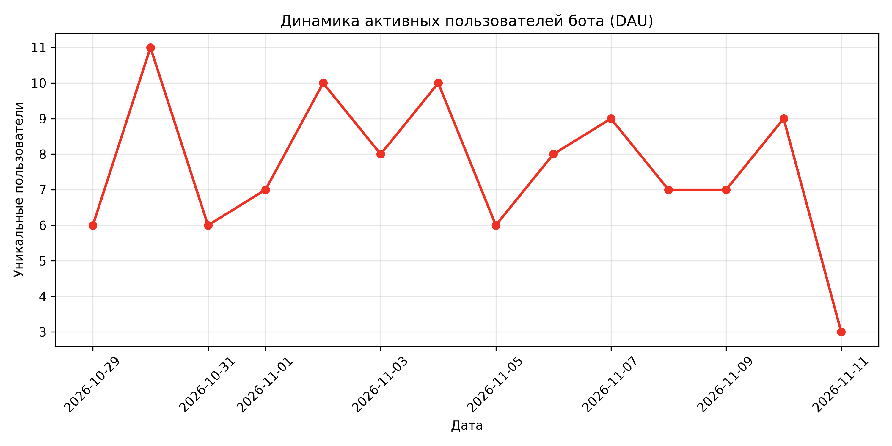

# knowledge_base — модуль подготовки базы знаний «Альфа-Курса»

Компонент трека 2 (ИИ-помощник в Telegram). Отвечает за подготовку данных, 
персонализацию рекомендаций и сбор метрик возврата пользователей.

## Что внутри

| Файл | Назначение |
|---|---|
| `chunker.py` | Нарезка материалов на чанки с метаданными для RAG |
| `meta.json` | Карточки материалов (тема, платность, стадия, уровень) |
| `schema.sql` | Схема БД: пользователи, профиль, события, напоминания |
| `mock_data.py` | Генерация тестовых данных (50 пользователей, 14 дней) |
| `tax_calendar.py` | Налоговый календарь по режимам (УСН/Патент/НПД/ОСНО) |
| `recommender.py` | Скоринг материалов по профилю + объяснение (Explainability) |
| `evaluate.py` | Оценка качества RAG-поиска: Hit@3 и доля честных отказов |
| `logger.py` | Хелпер для записи событий пользователей в БД |
| `metrics.py` | DAU/Retention, график для презентации |

## Метрики качества (на синтетическом тестовом наборе)
* **Hit@3 (Точность поиска)**: > 80% — правильный чанк попадает в топ-3 выдачи.
* **Доля честных отказов**: 100% — при отсутствии ответа в базе бот не галлюцинирует.

### Метрика возврата (DAU)


## Запуск

Установка зависимостей:
```bash
pip install pandas matplotlib scikit-learn